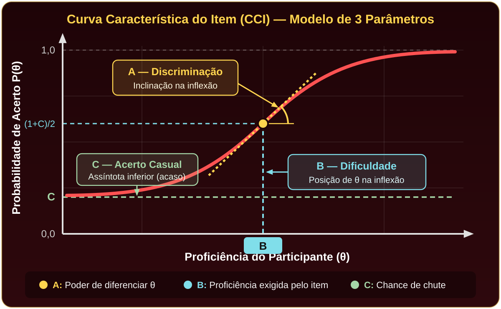
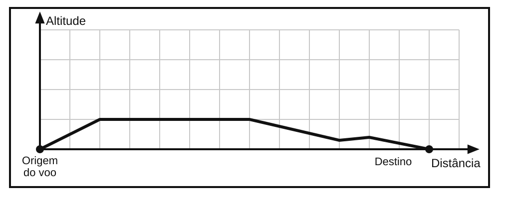
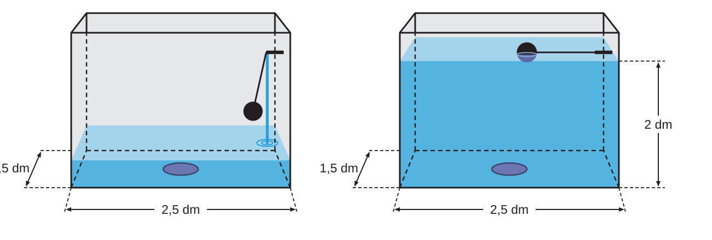
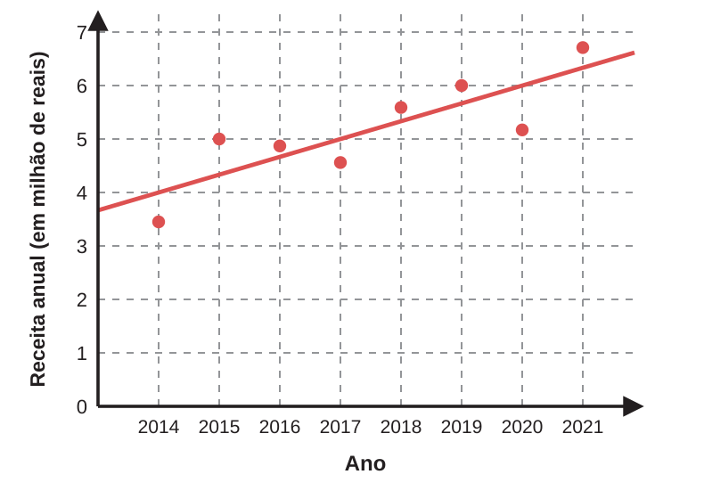

# Matemática Pré-Vestibular
## Aula 25 - IGNITE ENEM

*(Aguardando o início da transmissão)*

---

# TRI: não importa apenas quantas questões você acerta

A nota do ENEM não é calculada simplesmente pela soma dos acertos. A <strong>Teoria da Resposta ao Item (TRI)</strong> considera as características psicométricas de cada questão e o conjunto de respostas do participante para estimar sua <strong>proficiência (θ)</strong>.

<strong style="color:#FFD54F;">A — Discriminação:</strong> Capacidade da questão de diferenciar participantes com diferentes níveis de proficiência (inclinação da curva).

<strong style="color:#80DEEA;">B — Dificuldade:</strong> Indica o nível de proficiência (θ) associado à dificuldade da questão (ponto de inflexão da curva).

<strong style="color:#A5D6A7;">C — Acerto casual:</strong> Representa a probabilidade de acerto por acaso em uma questão de múltipla escolha.

<strong>⚖️ Mesma quantidade de acertos ≠ Mesma nota</strong> 
Dois estudantes com o mesmo total de acertos podem obter notas diferentes. As questões não possuem "pesos fixos" nem pontuação pré-definida: a TRI estima a proficiência pelo <strong>conjunto de respostas</strong>, avaliando quais itens foram acertados ou errados e seus parâmetros (<em>A, B, C</em>).

🎯 <strong>"Na TRI, o padrão de respostas também importa."</strong>
Ref.: INEP. <em>Entenda sua nota no ENEM: Guia do Participante</em>. Brasília, 2021.

---

# Matemática no ENEM: estratégia também conta

Construa um <strong>desempenho consistente</strong>: priorize as questões que você resolve com segurança e administre o tempo de prova.

<strong>1. Coerência Pedagógica das Respostas</strong> (8 questões ordenadas por dificuldade crescente → ambos com 5 acertos)
*Ilustração conceitual (sem notas numéricas atribuídas)

<table class="q-table">
  <tr>
    <th style="text-align:left;">Progressão de Dificuldade</th>
    <th>Fácil</th><th>Fácil</th><th>Média</th><th>Média</th><th>Média</th><th>Difícil</th><th>Difícil</th><th>Difícil</th>
    <th style="text-align:left;">Interpretação pelo Modelo da TRI</th>
  </tr>
  <tr>
    <td style="text-align:left;"><strong>ESTUDANTE A</strong> (5 acertos)</td>
    <td class="ok">✓</td><td class="ok">✓</td><td class="ok">✓</td><td class="ok">✓</td><td class="ok">✓</td><td class="err">✗</td><td class="err">✗</td><td class="err">✗</td>
    <td style="text-align:left; font-size:12px; color:#C8E6C9 !important;"><strong>Padrão mais coerente</strong> com a progressão esperada de proficiência.</td>
  </tr>
  <tr>
    <td style="text-align:left;"><strong>ESTUDANTE B</strong> (5 acertos)</td>
    <td class="err">✗</td><td class="err">✗</td><td class="ok">✓</td><td class="ok">✓</td><td class="err">✗</td><td class="ok">✓</td><td class="ok">✓</td><td class="ok">✓</td>
    <td style="text-align:left; font-size:12px; color:#FFCDD2 !important;"><strong>Inconsistências</strong> entre acertos e erros (influencia negativamente a estimativa).</td>
  </tr>
</table>

1ª PASSADA — QUESTÕES FÁCEIS
Resolva primeiro o que reconhece e desenvolve com segurança: 
• Porcentagem e proporcionalidade 
• Regra de três e escalas 
• Leitura de gráficos e tabelas 
• Estatística básica

2ª PASSADA — INTERMEDIÁRIAS
Retorne às questões que exigem mais interpretação, cálculos ou álgebra: 
• Funções e gráficos 
• Geometria plana e espacial 
• Problemas com múltiplas etapas 
• Aplicações de fórmulas prontas

3ª PASSADA — COMPLEXAS / LONGAS
Use o tempo restante nas de maior elaboração e pendências: 
• Combinatória e probabilidade 
• Problemas algébricos elaborados 
⚠️ <em>Técnica de gestão de tempo (não deixe itens em branco; a dificuldade real depende da questão!).</em>

🚀 <strong>"Primeiro, garanta aquilo que você domina. Depois, avance para os desafios."</strong>
Ref.: INEP. <em>Entenda sua nota no ENEM: Guia do Participante</em>. Brasília, 2021.

---

# Ignite ENEM

| Bloco de Conteúdo | Tempo Sugerido | Foco Principal da Revisão |
| :--- | :---: | :--- |
| **1. Matemática Básica e Grandezas** | 65 minutos | Regra de três (direta e inversa), escalas, porcentagem e conversão de unidades ($\text{m}^3$ para litros). |
| **2. Estatística e Gráficos** | 25 minutos | Diferença entre Média, Moda e Mediana, e pegadinhas comuns em leitura de gráficos. |
| **Intervalo / Pausa Mental** | 10 minutos | Descanso necessário para manter o foco na segunda metade da aula. |
| **3. Geometria (Espacial e Plana)** | 35 minutos | Fórmulas de volume (prismas e cilindros), projeção ortogonal e áreas de figuras planas. |
| **4. Funções e Álgebra** | 25 minutos | Interpretação de gráficos de 1º e 2º grau e o uso de logaritmos em fórmulas prontas. |
| **5. Probabilidade e Combinatória** | 20 minutos | Como diferenciar Arranjo de Combinação e o cálculo de probabilidade condicional. |

---

# Bloco 1 — Matemática Básica e Grandezas (Parte 1)

**Foco:** Regra de três (direta e inversa), escalas, porcentagem e conversão de unidades.

- **Grandezas Diretamente Proporcionais ($A \uparrow \, B \uparrow$):** A razão é constante:
  $$ \frac{A_1}{B_1} = \frac{A_2}{B_2} \quad (\text{multiplicação cruzada}) $$
- **Grandezas Inversamente Proporcionais ($A \uparrow \, B \downarrow$):** O produto é constante:
  $$ A_1 \cdot B_1 = A_2 \cdot B_2 \quad (\text{multiplicação em linha}) $$
- **Regra de Três Composta (Método Produto/Processo):**
  $$ \frac{\text{Processo}_1}{\text{Produto}_1} = \frac{\text{Processo}_2}{\text{Produto}_2} \implies \frac{(\text{Pessoas}_1 \cdot \text{Dias}_1 \cdot \text{Horas}_1)}{\text{Obra}_1} = \frac{(\text{Pessoas}_2 \cdot \text{Dias}_2 \cdot \text{Horas}_2)}{\text{Obra}_2} $$

**Como o ENEM cobra:** Questões de produtividade (equipes, voluntários, consumo semanal). Identifique sempre **o que é produzido** (muro, estandes, km rodados) e coloque no denominador!

---

# Bloco 1 — Matemática Básica e Grandezas (Parte 2)

- **Escalas Cartográficas e de Maquetes:**
  $$ E = \frac{d}{D} = \frac{\text{Medida no Desenho}}{\text{Medida Real}} \quad (\text{ambas na mesma unidade!}) $$
  - *Atenção:* De $\text{km}$ para $\text{cm}$, multiplicamos por $100\,000$ ($10^5$, ou seja, acrescentar 5 zeros).
  - Escala linear $1:k \implies$ Escala de **Área** $1:k^2 \implies$ Escala de **Volume** $1:k^3$.

- **Porcentagem e Fatores de Variação:**
  - "$30\%$ a menos que $X$" significa calcular **$70\%$ de $X$** ($0{,}70 \cdot X$), e **não** subtrair $30$ pontos percentuais!

- **Conversão de Unidades de Capacidade e Volume:**
  $$ 1\text{ m}^3 = 1\,000\text{ L} \quad \big| \quad 1\text{ dm}^3 = 1\text{ L} \quad \big| \quad 1\text{ cm}^3 = 1\text{ mL} $$

**Pegadinha Clássica ENEM:** Confundir desconto relativo ("$30\%$ a menos do que João acertou") com subtração direta de porcentagens ($75\% - 30\% = 45\%$ ❌ $\to$ correto: $0{,}7 \times 75\% = 52{,}5\%$ ✔️).

---

# Questão 136 --- ENEM 2025

Uma pessoa pretende instalar um kit de gás natural veicular (GNV) em seu carro. Na loja que escolheu para realizar a compra e instalação desse kit, havia cinco modelos de cilindro para armazenamento do gás, cujas capacidades, em metro cúbico, eram, respectivamente: $10$, $14$, $17$, $21$ e $25$. O preço do cilindro é proporcional à sua capacidade. Esse carro rodará $30\text{ km}$ diariamente, $7\text{ dias}$ por semana, e o consumo do GNV é de $1\text{ m}^3$ a cada $13\text{ km}$ rodados. A pessoa escolherá o modelo de cilindro de menor preço e que garanta apenas um abastecimento semanal.

Nessas condições, qual será a capacidade, em metro cúbico, do cilindro escolhido por essa pessoa?

(A) $10$
(B) $14$
(C) $17$
(D) $21$
(E) $25$

---

# Questão 147 --- ENEM PPL 2024

Um engenheiro civil organizou duas equipes de pedreiros, I e II, para a construção de um muro bastante extenso. Todos os pedreiros, de ambas as equipes, apresentam o mesmo rendimento por hora trabalhada frente à construção planejada. A equipe I era composta por $3$ pedreiros, que construíram $36\text{ metros quadrados}$ de muro, em $2\text{ dias}$, trabalhando $6\text{ horas por dia}$. A equipe II era composta por $5$ pedreiros, que trabalharam $8\text{ horas diárias}$, durante $6\text{ dias}$.

Quantos metros quadrados a equipe II construiu a mais do que a equipe I?

(A) $144$
(B) $180$
(C) $204$
(D) $240$
(E) $276$

---

# Questão 148 --- ENEM PPL 2024

Na primeira edição de uma Feira do Livro, a organização contou com a participação de dez voluntários, de mesma habilidade e experiência, que montaram cinco estandes de livros em uma semana, trabalhando todos os dias.

Na segunda edição da Feira do Livro, a organização dispôs de duas semanas para montar os estandes. Considere que todos os novos voluntários escolhidos tenham a mesma experiência, habilidade e produtividade dos voluntários da primeira edição da feira e que trabalharão todos os dias nessas duas semanas.

Considere duas situações para a segunda edição:
- **I:** o número de voluntários permanecerá o mesmo;
- **II:** o número de estandes a serem montados permanecerá o mesmo.

Observe que o aumento no tempo de organização para montar os estandes, junto a uma das duas situações citadas, pode fazer o valor das outras variáveis (número de voluntários e de estandes) aumentar, diminuir ou permanecer igual.

O número de estandes na situação I e o número de voluntários na situação II, na segunda edição da feira, comparados aos números da primeira edição, serão, respectivamente,

(A) maior e maior.
(B) maior e menor.
(C) igual e igual.
(D) igual e menor.
(E) menor e menor.

---

# Questão 149 --- ENEM 2023

Um controlador de voo dispõe de um instrumento que descreve a altitude de uma aeronave em voo, em função da distância em solo. Essa distância em solo é a medida na horizontal entre o ponto de origem do voo até o ponto que representa a projeção ortogonal da posição da aeronave, em voo, no solo. Essas duas grandezas são dadas numa mesma unidade de medida.

A tela do instrumento representa proporcionalmente as dimensões reais das distâncias associadas ao voo. A figura apresenta a tela do instrumento depois de concluída a viagem de um avião, sendo a medida do lado de cada quadradinho da malha igual a $1\text{ cm}$.

Essa tela apresenta os dados de um voo cuja maior altitude alcançada foi de $5\text{ km}$.
A escala em que essa tela representa as medidas reais é

(A) $1 : 5$. &nbsp;&nbsp; (B) $1 : 11$. &nbsp;&nbsp; (C) $1 : 55$. &nbsp;&nbsp; (D) $1 : 5\,000$. &nbsp;&nbsp; (E) $1 : 500\,000$.

---

# Questão 140 --- ENEM 2024

João e Felipe participaram, na escola, de uma maratona de matemática na qual, durante uma semana, resolveram $200$ questões cada. Nessa maratona, a porcentagem $P$ de acertos de cada participante é convertida em um conceito:

- **insatisfatório:** se $0 \le P < 50$;
- **regular:** se $50 \le P < 60$;
- **bom:** se $60 \le P < 75$;
- **muito bom:** se $75 \le P < 90$;
- **excelente:** se $90 \le P \le 100$.

João acertou $75\%$ das questões da maratona e Felipe acertou $30\%$ a menos que a quantidade de questões que João acertou.

Os conceitos de João e Felipe foram, respectivamente,

(A) muito bom e bom.
(B) muito bom e regular.
(C) muito bom e insatisfatório.
(D) bom e regular.
(E) bom e insatisfatório.

---

# Questão 178 --- ENEM 2015

Para economizar em suas contas mensais de água, uma família de $10$ pessoas deseja construir um reservatório para armazenar a água captada das chuvas, que tenha capacidade suficiente para abastecer a família por $20$ dias. Cada pessoa da família consome, diariamente, $0{,}08\text{ m}^3$ de água.

Para que os objetivos da família sejam atingidos, a capacidade mínima, em litros, do reservatório a ser construído deve ser:

(A) $16$
(B) $800$
(C) $1\,600$
(D) $8\,000$
(E) $16\,000$

---

# Bloco 2 — Estatística e Gráficos

**Foco:** Diferença entre Média, Moda e Mediana, e pegadinhas em leitura de gráficos e tabelas.

- **Média Aritmética ($\bar{x}$):** Soma de todos os valores dividida pelo total de elementos (ou ponderada pelas frequências $f_i$):
  $$ \bar{x} = \frac{x_1 f_1 + x_2 f_2 + \dots + x_k f_k}{f_1 + f_2 + \dots + f_k} $$
- **Moda ($M_o$):** O valor da variável que aparece com **maior frequência** (o pico do gráfico de barras).
- **Mediana ($M_d$):** Termo central dos dados **obrigatoriamente colocados em rol (ordem crescente)**:
  - Se $N$ é ímpar: termo na posição $\frac{N+1}{2}$.
  - Se $N$ é par: média aritmética dos dois termos centrais, nas posições $\frac{N}{2}$ e $\frac{N}{2} + 1$.

**Pegadinhas Clássicas do ENEM:**
1. Calcular a mediana **sem ordenar** a lista antes!
2. Em tabelas/gráficos de frequência, confundir a **frequência** (qtd. de motoristas) com o **valor da variável** (nº de viagens). Use a frequência acumulada para achar a posição central!

---

# Questão 154 --- ENEM 2024

Contratos de vários serviços disponíveis na internet apresentam uma quantidade excessiva de informações. Isso faz com que o tempo necessário para a leitura desses contratos possa ser longo.

O quadro apresenta uma amostra do tempo considerado necessário para a leitura completa do contrato de alguns serviços digitais.

| Serviço | Tempo (minuto) |
| :---: | :---: |
| A | $36$ |
| B | $17$ |
| C | $27$ |
| D | $13$ |
| E | $13$ |
| F | $13$ |

ROMERO, L. Não li e concordo. *Superinteressante*, n. 307, ago. 2012 (adaptado).

O tempo médio, em minuto, necessário para a leitura completa de um contrato de serviço dentre os listados no quadro é, com uma casa decimal, aproximadamente,

(A) $13{,}0$. &nbsp;&nbsp; (B) $15{,}0$. &nbsp;&nbsp; (C) $19{,}8$. &nbsp;&nbsp; (D) $20{,}0$. &nbsp;&nbsp; (E) $23{,}3$.

---

# Questão 178 --- ENEM 2024

A umidade relativa do ar é um dos indicadores utilizados na meteorologia para fazer previsões sobre o clima. O quadro apresenta as médias mensais, em porcentagem, da umidade relativa do ar em um período de seis meses consecutivos em uma cidade.

| Meses | Maio | Junho | Julho | Agosto | Setembro | Outubro |
| :--- | :---: | :---: | :---: | :---: | :---: | :---: |
| **Umidade (%)** | $66$ | $64$ | $54$ | $46$ | $60$ | $64$ |

Nessa cidade, a mediana desses dados, em porcentagem, da umidade relativa do ar no período considerado foi:

(A) $56$.
(B) $58$.
(C) $59$.
(D) $60$.
(E) $62$.

---

# Questão 140 --- ENEM 2023

Uma empresa de transporte faz regularmente um levantamento do número de viagens realizadas durante o dia por todos os $160$ motoristas cadastrados em seu aplicativo. Em um certo dia, foi gerado um relatório, por meio de um gráfico de barras, no qual se relacionaram a quantidade de motoristas com a quantidade de viagens realizadas até aquele instante do dia.

A distribuição da frequência da quantidade de viagens por motorista é dada por:
- $1$ viagem: $10$ motoristas
- $2$ viagens: $10$ motoristas
- $3$ viagens: $55$ motoristas
- $4$ viagens: $25$ motoristas
- $5$ viagens: $0$ motoristas
- $6$ viagens: $50$ motoristas
- $7$ viagens: $10$ motoristas

Comparando os valores da média, da mediana e da moda da distribuição das quantidades de viagens realizadas pelos motoristas cadastrados nessa empresa, obtém-se:

(A) $\text{mediana} = \text{média} < \text{moda}$
(B) $\text{mediana} = \text{moda} < \text{média}$
(C) $\text{mediana} < \text{média} < \text{moda}$
(D) $\text{moda} < \text{média} < \text{mediana}$
(E) $\text{moda} < \text{mediana} < \text{média}$

---

# ☕ Intervalo / Pausa Mental — 10 Minutos

## Descanso necessário para manter o foco na segunda metade da aula!

**Na volta (Segunda Metade):**
- **Bloco 3:** Geometria Espacial e Plana (Volumes, Áreas e Projeções)
- **Bloco 4:** Funções (1º e 2º Grau) e Logaritmos em Fórmulas
- **Bloco 5:** Análise Combinatória e Probabilidade Condicional

---

# Bloco 3 — Geometria (Espacial e Plana)

**Foco:** Fórmulas de volume (prismas e cilindros), projeção ortogonal e áreas de figuras planas.

- **Áreas de Figuras Planas Essenciais:**
  - Retângulo: $A = b \cdot h$ &nbsp;|&nbsp; Triângulo: $A = \frac{b \cdot h}{2}$ &nbsp;|&nbsp; Círculo: $A = \pi R^2$.
  - *Atenção:* Redução de área $\Delta A = A_{\text{inicial}} - A_{\text{final}}$ (nunca multiplique as diferenças dos lados!).

- **Volume de Prismas e Cilindros (Tem topo igual à base):**
  $$ V = A_{\text{base}} \cdot h $$
  - **Paralelepípedo reto-retângulo:** $V = a \cdot b \cdot c$.
  - **Cilindro circular reto:** $V = \pi R^2 \cdot h$.
  - *(Se tiver ponta — pirâmide ou cone — divide por 3: $V = \frac{A_{\text{base}} \cdot h}{3}$).*

- **Projeção Ortogonal:** É a "sombra" perpendicular da figura/trajetória sobre o plano de referência (solo).

**Dica de Ouro ENEM:** Se as dimensões já estão em **decímetros ($\text{dm}$)**, calcule o volume direto em $\text{dm}^3$, pois $1\text{ dm}^3 = 1\text{ Litro}$! E lembre: objeto submerso desloca um volume de água igual ao seu próprio volume (Arquimedes).

---

# Questão 145 --- ENEM 2024

O estádio do Maracanã passou por algumas modificações estruturais para a realização da Copa do Mundo de 2014, como, por exemplo, as dimensões do campo retangular. Para se adaptar aos padrões da Fifa, as dimensões do campo foram reduzidas de $110\text{ m} \times 75\text{ m}$ para $105\text{ m} \times 68\text{ m}$.

Em quantos metros quadrados a área do campo do Maracanã foi reduzida?

(A) $24$
(B) $35$
(C) $555$
(D) $1\,110$
(E) $1\,145$

---

# Questão 142 --- ENEM 2023

A água utilizada pelos $75$ moradores de um vilarejo provém de um reservatório de formato cilíndrico circular reto cujo raio da base mede $5\text{ metros}$, sempre abastecido no primeiro dia de cada mês por caminhões-pipa. Cada morador desse vilarejo consome, em média, $200\text{ litros}$ de água por dia.

No mês de junho de um determinado ano, o vilarejo festejou o dia do seu padroeiro e houve um gasto extra de água nos primeiros $20\text{ dias}$. Passado esse período, as pessoas verificaram a quantidade de água presente no reservatório e constataram que o nível da coluna de água estava em $1{,}5\text{ metro}$. Decidiram, então, fazer um racionamento de água durante os $10\text{ dias}$ seguintes. Considere $3$ como aproximação para $\pi$.

Qual é a quantidade mínima de água, em litro, que cada morador, em média, deverá economizar por dia, de modo que o reservatório não fique sem água nos próximos $10\text{ dias}$?

(A) $50$
(B) $60$
(C) $80$
(D) $140$
(E) $150$

---

# Questão 170 --- ENEM 2025

Uma caixa de descarga, acoplada a um vaso sanitário, tem a forma de paralelepípedo reto retângulo cujas dimensões internas da base são $2{,}5\text{ dm}$ e $1{,}5\text{ dm}$. Nessa caixa há uma boia que interrompe o abastecimento quando a altura da coluna de água atinge $2\text{ dm}$, conforme a figura.

A cada acionamento da descarga, todo o volume de água contida na caixa é despejado no vaso. Para reduzir o volume de água despejado a cada acionamento, uma pessoa colocará, no interior dessa caixa, garrafas de $300\text{ mL}$, cheias de areia e tampadas, de modo a ficarem submersas quando o abastecimento for interrompido.

Para garantir o funcionamento eficiente, o mínimo de água despejada a cada acionamento deve ser de $5\text{ L}$.

A quantidade máxima de garrafas que serão colocadas nessa caixa, garantindo um funcionamento eficiente, é igual a

(A) $10$. &nbsp;&nbsp; (B) $8$. &nbsp;&nbsp; (C) $4$. &nbsp;&nbsp; (D) $3$. &nbsp;&nbsp; (E) $2$.

---

# Bloco 4 — Funções e Álgebra

**Foco:** Interpretação de gráficos de 1º e 2º grau e uso de logaritmos em fórmulas prontas.

- **Função Afim (1º Grau — Reta de Tendência): $f(x) = ax + b$**
  - Taxa de variação constante ($a = \frac{\Delta y}{\Delta x}$): a cada aumento fixo em $x$, o valor de $y$ aumenta sempre na mesma proporção!
  - *Dica no gráfico:* Escolha dois pontos **exatos** onde a reta cruza a grade pontilhada.

- **Função Quadrática (2º Grau — Parábola): $f(x) = ax^2 + bx + c$**
  - Quando a questão pede **"maior quantidade" (máximo)** ou **"menor custo" (mínimo)**:
    $$ x_V = -\frac{b}{2a} = \frac{x_1 + x_2}{2} \quad \text{(quando ocorrerá)} \qquad \big| \qquad y_V = -\frac{\Delta}{4a} = f(x_V) \quad \text{(qual o valor máximo/mínimo)} $$

- **Logaritmos em Fórmulas Prontas:**
  - Definição e potências de 10: $\log_{10}(10^k) = k \implies \log(10) = 1$, $\log(100) = 2$, $\log(0{,}1) = -1$.
  - Propriedade: $\log(A \cdot B) = \log A + \log B$ e $\log\left(\frac{A}{B}\right) = \log A - \log B$.

**Como o ENEM cobra $x_V$ vs. $y_V$:** Se a pergunta pede **o mês / o tempo / o preço** que gera o máximo, calcule apenas o **$x_V = -\frac{b}{2a}$**! Só calcule $y_V$ se pedir a quantidade máxima em si.

---

# Questão 170 --- ENEM 2024

Em uma região com grande incidência de terremotos, observou-se que dois terremotos ocorridos apresentaram magnitudes $M_1$ e $M_2$, medidos segundo a escala Richter, e liberaram energias iguais a $E_1$ e $E_2$, respectivamente. Entre os estudiosos do assunto, é conhecida uma expressão algébrica relacionando esses valores dada por
$$ M_2 - M_1 = \frac{2}{3} \log \left(\frac{E_2}{E_1}\right) $$

Estudos mais abrangentes observaram que o primeiro terremoto apresentou a magnitude $M_1 = 6{,}9$ e a energia liberada foi um décimo da observada no segundo terremoto.

O valor aproximado da magnitude $M_2$ do segundo terremoto, expresso com uma casa decimal, é igual a

(A) $5{,}4$.
(B) $6{,}2$.
(C) $7{,}6$.
(D) $8{,}2$.
(E) $8{,}4$.

---

# Questão 176 --- ENEM 2024

As receitas anuais obtidas por uma indústria no período de $2014$ a $2021$, em milhão de reais, foram registradas, por pontos, em um gráfico. Nele, também está representada a reta que descreve a tendência de evolução das receitas. Essa reta pode ser utilizada para estimar as receitas dos anos seguintes.

A estimativa da receita, em milhão de reais, dessa indústria, para o ano de $2026$, obtida a partir dessa reta de tendência, é

(A) $7$. &nbsp;&nbsp; (B) $8$. &nbsp;&nbsp; (C) $9$. &nbsp;&nbsp; (D) $10$. &nbsp;&nbsp; (E) $11$.

---

# Questão 158 --- ENEM 2022

Ao analisar os dados de uma epidemia em uma cidade, peritos obtiveram um modelo que avalia a quantidade de pessoas infectadas a cada mês, ao longo de um ano. O modelo é dado por $p(t) = -t^2 + 10t + 24$, sendo $t$ um número natural, variando de $1$ a $12$, que representa os meses do ano, e $p(t)$ a quantidade de pessoas infectadas no mês $t$ do ano. Para tentar diminuir o número de infectados no próximo ano, a Secretaria Municipal de Saúde decidiu intensificar a propaganda oficial sobre os cuidados com a epidemia. Foram apresentadas cinco propostas (I, II, III, IV e V), com diferentes períodos de intensificação das propagandas:

- **I:** $1 \le t \le 2$;
- **II:** $3 \le t \le 4$;
- **III:** $5 \le t \le 6$;
- **IV:** $7 \le t \le 9$;
- **V:** $10 \le t \le 12$.

A sugestão dos peritos é que seja escolhida a proposta cujo período de intensificação da propaganda englobe o mês em que, segundo o modelo, há a maior quantidade de infectados. A sugestão foi aceita.

A proposta escolhida foi a

(A) I. &nbsp;&nbsp; (B) II. &nbsp;&nbsp; (C) III. &nbsp;&nbsp; (D) IV. &nbsp;&nbsp; (E) V.

---

# Bloco 5 — Probabilidade e Combinatória

**Foco:** Como diferenciar Arranjo de Combinação e o cálculo de probabilidade condicional.

- **Arranjo vs. Combinação (A Pergunta de Ouro: *A ordem importa?*):**
  - **SIM (Senhas, Pódio, Códigos):** Use o Princípio Fundamental da Contagem (tracinhos) ou Arranjo: $A_{n, p} = \dfrac{n!}{(n - p)!}$.
  - **NÃO (Comissões, Duplas, Partidas em turno único):** Divida pela permutação repetida (Combinação):
    $$ C_{n, p} = \frac{n!}{p!(n - p)!} \quad \implies \quad \text{Para duplas/jogos } (p=2): \; C_{n, 2} = \frac{n(n - 1)}{2} $$

- **Probabilidade e Probabilidade Condicional:**
  - Definição: $P(A) = \dfrac{\text{Casos Favoráveis}}{\text{Total de Casos Possíveis}}$.
  - **Probabilidade Condicional / Teorema de Bayes ($P(M_2 \mid \text{Defeituosa})$):** Restrinja o universo apenas à condição que já ocorreu!
    $$ P(M_2 \mid D) = \frac{\text{Defeituosas de } M_2}{\text{Total de Defeituosas } (M_1 + M_2 + M_3)} $$

**Dica Prática ENEM:** Em problemas de máquinas/testes com porcentagens, imagine uma produção total de **$1\,000$ ou $10\,000$ peças**! Transformar porcentagens em números inteiros elimina as casas decimais.

---

# Questão 178 --- ENEM 2017

Como não são adeptos da prática de esportes, um grupo de amigos resolveu fazer um torneio de futebol utilizando videogame. Decidiram que cada jogador joga uma única vez com cada um dos outros jogadores. O campeão será aquele que conseguir o maior número de pontos. Observaram que o número de partidas jogadas depende do número de jogadores, como mostra o quadro:

| Quantidade de jogadores | $2$ | $3$ | $4$ | $5$ | $6$ | $7$ |
| :--- | :---: | :---: | :---: | :---: | :---: | :---: |
| **Número de partidas** | $1$ | $3$ | $6$ | $10$ | $15$ | $21$ |

Se a quantidade de jogadores for $8$, quantas partidas serão realizadas?

(A) $64$
(B) $56$
(C) $49$
(D) $36$
(E) $28$

---

# Questão 150 --- ENEM 2021 PPL

A senha de um cofre é uma sequência formada por oito dígitos, que são algarismos escolhidos de $0$ a $9$. Ao inseri-la, o usuário se esqueceu dos dois últimos dígitos que formam essa senha, lembrando somente que esses dígitos são distintos.

Digitando ao acaso os dois dígitos esquecidos, a probabilidade de que o usuário acerte a senha na primeira tentativa é

(A) $\dfrac{2}{8}$

(B) $\dfrac{1}{90}$

(C) $\dfrac{2}{90}$

(D) $\dfrac{1}{100}$

(E) $\dfrac{2}{100}$

---

# Questão 149 --- ENEM 2021 PPL

Em uma fábrica de circuitos elétricos, há diversas linhas de produção e montagem. De acordo com o controle de qualidade da fábrica, as peças produzidas devem seguir um padrão. Em um processo produtivo, nem todas as peças produzidas são totalmente aproveitáveis, ou seja, há um percentual de peças defeituosas que são descartadas.

Em uma linha de produção dessa fábrica, trabalham três máquinas, $M_1$, $M_2$ e $M_3$, dia e noite. A máquina $M_1$ produz $25\%$ das peças, a máquina $M_2$ produz $30\%$ e a máquina $M_3$ produz $45\%$. O percentual de peças defeituosas da máquina $M_1$ é de $2\%$, da máquina $M_2$ é de $3\%$ e da máquina $M_3$ é igual a $4\%$.

A probabilidade de uma peça defeituosa ter sido produzida pela máquina $M_2$ é mais próxima de

(A) $15{,}6\%$
(B) $28{,}1\%$
(C) $43{,}7\%$
(D) $56{,}2\%$
(E) $71{,}8\%$

